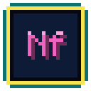

<!-- amigo-labs header: generated by amigo-labs/website scripts/readme-header.ts -->

  

<h1 align="center">Neoforo</h1>

  
  
  
  

<!-- /amigo-labs header -->

In planning. Vision and decisions: [`00-vision.md`](00-vision.md); the work plan: [`PLAN.md`](PLAN.md).
